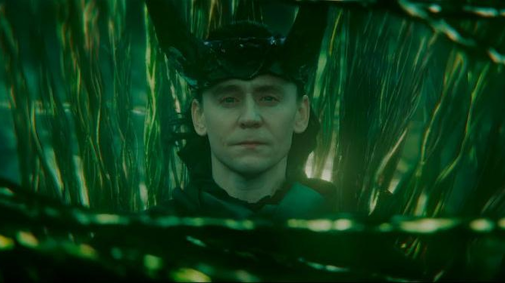

# 🌿 Omarchy God of Stories (Loki × Multiversal Yggdrasil)

> *"I know what kind of god I need to be. For you. For all of us."*
>
> Complete, mystical, high-focus dark aesthetic suite for **Omarchy Linux** (Arch + Hyprland + Quickshell). Built for developers, hackers, and night-owls weaving their own multiversal branches into code.



---

## 🎨 Design Philosophy
- **Temporal Void Black (`#060b08`)**: The quiet darkness at the End of Time beyond the Citadel, eliminating monitor eye strain completely.
- **Living Timeline Strand (`#10b981` / `#34d399`)**: Electric emerald multiverse strands weaving through active window borders, terminal accents, and visualizers.
- **Asgardian Crown Gold (`#eab308`)**: Rich royal golden accents signifying sacrifice, destiny, and mastery over time.
- **Ethereal Mist Typography (`#ecfdf5`)**: Clean, crisp, low-fatigue white typography for distraction-free extended hacking sessions.

---

## 📦 What's Included in the Suite
| Subsystem / Application | Themed Component |
| :--- | :--- |
| **Omarchy Core** | `colors.toml` (Official Omarchy 19-app palette specification) |
| **Theme Definition** | `themes/theme.toml` (Engine tokens, bar & window styling) |
| **Window Manager** | `hyprland.conf` (45° Emerald / Gold animated dual gradient borders) |
| **Lockscreen** | `hyprlock.conf` (Cinematic blurred timeline background with emerald inputs) |
| **System Monitor** | `btop.theme` (Emerald, gold, and sacred cyan timeline meters) |
| **App Launcher** | `walker.css` (Glassmorphic floating spotlight search) |
| **Audio Visualizer** | `cava_theme` (Smooth multiversal gradient spectrum) |
| **GTK 3 & 4** | `gtk-3.0/gtk.css` & `gtk-4.0/gtk.css` (Native file managers, menus) |
| **Note Taking** | `obsidian.css` (Markdown notes with emerald timeline accents) |
| **Wallpapers** | `wallpapers/loki_god_of_stories.jpg` (Full HD 1080p widescreen desktop artwork) |

---

## 🚀 Installation

### 1. In Omarchy Linux (via Terminal)
```bash
omarchy-theme-install https://github.com/arsh240311/omarchy-god-of-stories
```

### 2. Manual Activation
```bash
git clone https://github.com/arsh240311/omarchy-god-of-stories ~/.config/omarchy/themes/god-of-stories
omarchy-theme-set god-of-stories
```

---

## 👤 Author
- **Fasid Arshafwan** ([@arsh240311](https://github.com/arsh240311))
- *Built with Antigravity & OpenCode on Arch Linux.*
